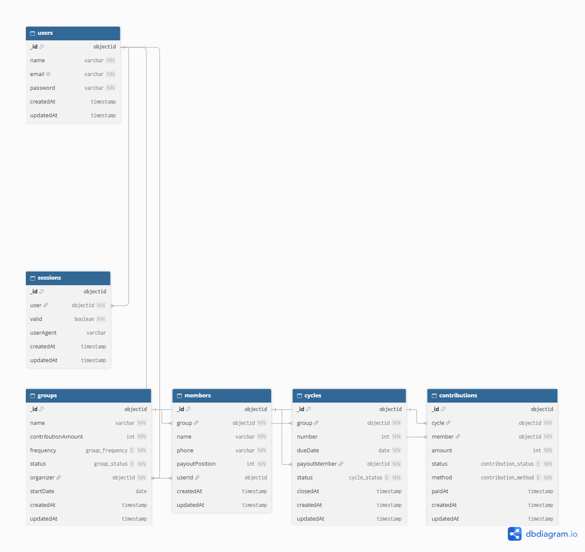
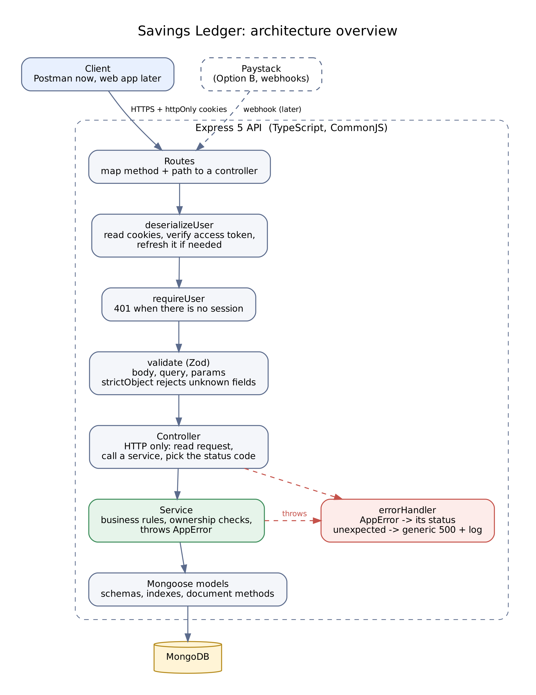
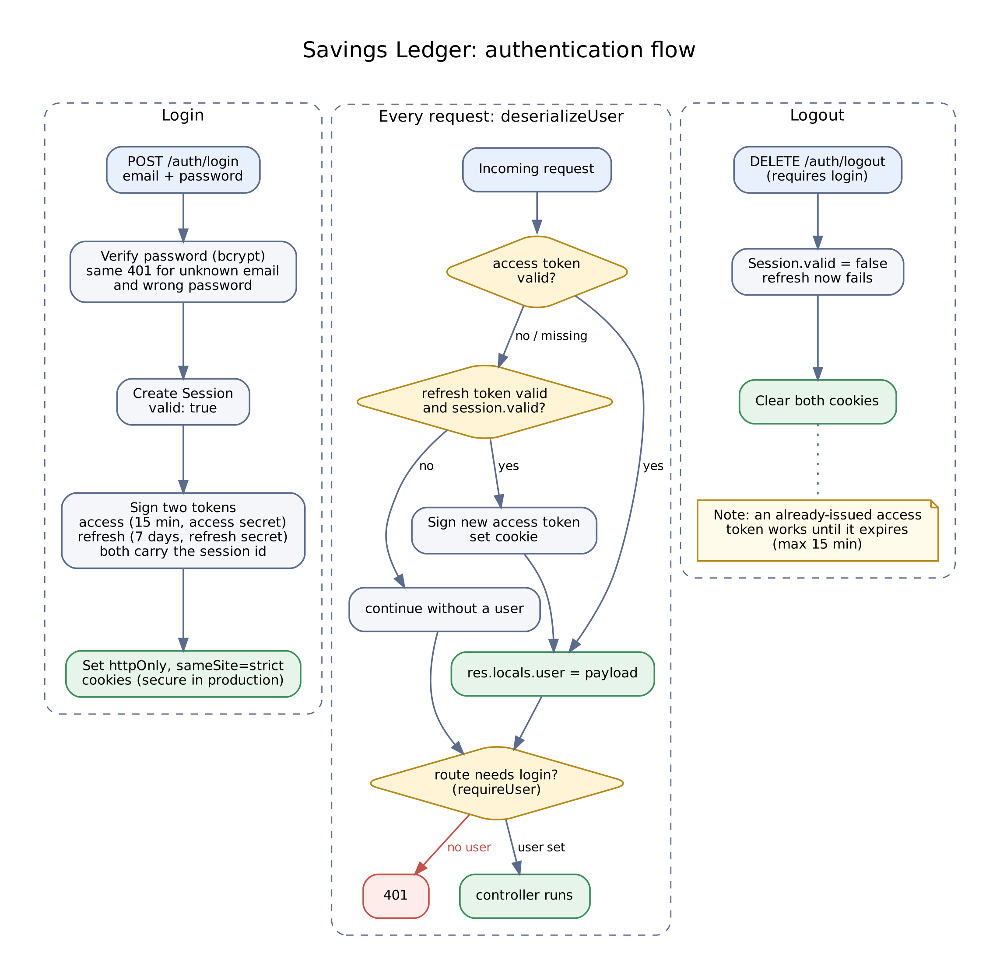

# Savings Ledger API

A backend API for running ajo (rotating savings) groups: members, contribution cycles and payout order.

> **Status:** In progress. Accounts, sessions, groups and adding members to a group are built. Starting a group, cycles, recording contributions and the group summary are planned, not built. A code review found a few security and correctness issues that are listed with their fixes in [`docs/Api-spec.md`](./docs/Api-spec.md), section 10. Anything not marked **Done** is planned.

## The problem

Ajo is a rotating savings tradition. A group of people each pay a fixed amount on a schedule, and each round the whole pot goes to one member, in a set order, until everyone has collected once. The organizer usually keeps track in a notebook or a WhatsApp group: who has paid, who is late, whose turn it is. That is where the disputes start: "I paid last week", "why is she collecting before me?"

Savings Ledger gives the organizer one place to record that, with a history nobody has to argue about.

## Who it is for

- **Organizers** create a group, add members, and record who has paid each round.
- **Members** are records the organizer manages. They do not have accounts yet.

## Core idea

A group moves through a lifecycle:

`draft` → `active` → `completed`

While a group is a draft, the organizer sets the amount, frequency and members. Each member gets a position in the payout order. Once the group starts, each round (cycle) names who collects, and the organizer records each member's contribution. When every cycle has closed, the group is complete.

Members are kept separate from user accounts on purpose. Later, members can get their own logins and pay through the app (Paystack) without changing how cycles and payouts work.

Money is stored as whole numbers of kobo, so NGN 10,000 is `1000000`. This avoids floating-point errors.

## Tech stack

| Layer | Choice |
| --- | --- |
| Runtime | Node.js |
| Language | TypeScript |
| Framework | Express 5 |
| Database | MongoDB (Mongoose) |
| Validation | Zod |
| Authentication | JWT access and refresh tokens in httpOnly cookies, bcrypt password hashing, stored sessions |
| Logging | pino |
| Testing | Jest, ts-jest, Supertest, mongodb-memory-server |

**Why MongoDB:** groups, members, cycles and contributions are separate collections that reference each other by ID, and the data is read per group, which suits documents and indexes on `group`.

## Data model (summary)

Built: **User**, **Session**, **Group**, **Member**. Planned: **Cycle**, **Contribution**.



## Architecture



A layered monolith organised by feature. A request passes through authentication and validation middleware, then a route and controller, then a service (the business rules), then a Mongoose model. Services throw errors, and one global error handler turns them into responses.



## Authentication and access

- Register, then log in. Login sets `accessToken` (15 minutes) and `refreshToken` (7 days) cookies, signed with separate secrets. An expired access token is renewed from the refresh token while its session is still valid.
- Every login creates a session record. Logging out marks it invalid, so the refresh token stops working.
- The person who creates a group is its organizer. The organizer comes from the login, and a request that tries to send `organizer` or `status` is rejected.
- A group that belongs to someone else returns `404`, the same as one that does not exist, so ids cannot be probed.

| Action | Who |
| --- | --- |
| Register, log in | Anyone |
| Create a group | Logged in |
| Update a group | Its organizer, while it is a draft |
| Delete a group | Its organizer, once it is completed |
| Add a member | The group's organizer, while it is a draft |

Reading a group and updating a user are currently not limited to their owner. These are the first items to fix (see the API spec, section 10.1).

## Security

Done:
- Passwords are hashed with bcrypt, and the hash is never returned.
- Tokens live in httpOnly, `sameSite=strict` cookies (`secure` in production). Access and refresh tokens use different secrets.
- Group and member requests use strict Zod schemas, so unknown fields are rejected with a 400. Request bodies, query strings and ids are validated.
- Unexpected errors return a generic message and are logged on the server. Stack traces never reach the client.

Not done yet: security headers (`helmet`), rate limiting, a request size limit, restricted CORS, and a startup check for missing secrets. Details, and the review findings I am fixing first, are in [`docs/security.md`](./docs/security.md) and the API spec.

## API overview

Base path: `/api/v1`. The full spec, with request bodies, responses and status codes, is in [`docs/Api-spec.md`](./docs/Api-spec.md).

| Area | Endpoints | Status |
| --- | --- | --- |
| Health | `GET /health` | Done |
| Auth | `POST /auth` (register), `POST /auth/login`, `DELETE /auth/logout` | Done |
| Users | `GET /users/:id`, `PATCH /users/:id` | Done |
| Groups | `POST /groups`, `GET /groups/:id`, `PATCH /groups/:groupId`, `DELETE /groups/:groupId` | Done |
| Members | `POST /members/:groupId` | Done |
| Groups | List my groups, start a group, group summary | Planned |
| Members | List, update, remove, reorder | Planned |
| Cycles and contributions | Open and close cycles, record a payment | Planned |

**Errors** use one of these shapes:

```json
{ "message": "Group not found" }
```

```json
{
  "message": "Validation failed",
  "errors": [{ "field": "body.frequency", "message": "a frequency is required" }]
}
```

### Try it

```bash
# register
curl -X POST http://localhost:5000/api/v1/auth \
  -H "Content-Type: application/json" \
  -d '{"name":"Ada","email":"ada@example.com","password":"secret123","passwordConfirmation":"secret123"}'

# log in (saves the cookies to a file)
curl -c cookies.txt -X POST http://localhost:5000/api/v1/auth/login \
  -H "Content-Type: application/json" \
  -d '{"email":"ada@example.com","password":"secret123"}'

# create a group (sends the saved cookies)
curl -b cookies.txt -X POST http://localhost:5000/api/v1/groups \
  -H "Content-Type: application/json" \
  -d '{"name":"Market Women Ajo","contributionAmount":1000000,"frequency":"weekly","startDate":"2026-11-01"}'
```

On Windows PowerShell, use `curl.exe` instead of `curl`. Postman also works: it keeps the cookies for you.

## Getting started

### Prerequisites

- Node.js 20 or later
- A MongoDB database (local, or a free MongoDB Atlas cluster)

### Setup

```bash
git clone https://github.com/Ajibzrahz/savings-ledger.git
cd savings-ledger
npm install
cp .env.example .env
```

On Windows PowerShell, use `Copy-Item .env.example .env` instead of `cp`. Then open `.env` and fill in the values.

### Environment variables

| Variable | Description |
| --- | --- |
| `NODE_ENV` | `development`, `test` or `production` |
| `PORT` | Port the server listens on (default 5000) |
| `MONGO_URI` | MongoDB connection string |
| `ACCESS_TOKEN_SECRET` | Long random string used to sign access tokens |
| `REFRESH_TOKEN_SECRET` | A different long random string used to sign refresh tokens |
| `ACCESS_TOKEN_TTL` | Access token lifetime in seconds (default 900) |
| `REFRESH_TOKEN_TTL` | Refresh token lifetime in seconds (default 604800) |

Generate a secret with:

```bash
node -e "console.log(require('crypto').randomBytes(48).toString('hex'))"
```

Never commit your real `.env`. It is listed in `.gitignore`.

### Run

```bash
npm run dev     # development with auto-reload
npm run build   # compile TypeScript to dist/
npm start       # run the compiled build
```

### Test

```bash
npm test                 # run all tests
npm run test:coverage    # run all tests and print the coverage report
```

The test setup is in place: Jest with ts-jest, Supertest to call the real Express app, and mongodb-memory-server so tests never touch a real database. **The first run that starts the in-memory database downloads a MongoDB binary and can take a few minutes.** It is cached afterwards.

**Current state:** there is one test, for the health check, and it needs updating to match the app (the app serves `GET /health`). Tests for authentication, groups and members are the next thing I am writing.

## Project structure

```
docs/            API spec, ERD, architecture and auth-flow diagrams, security and performance notes
src/
  app.ts           Express app (middleware, routes, error handler)
  server.ts        Entry point: connect to the database, then listen
  config/          environment and database setup
  middleware/      deserializeUser, requireUser, validate (Zod), error handler
  modules/         auth, user, session, group, member
                   (each has its route, controller, service, schema and model)
  common/          route index and shared utilities (JWT, logger, id checks, shared schemas)
tests/             Jest and Supertest tests
```

## Roadmap

1. Fix the issues found in review (API spec, section 10.1), then add tests for authentication, groups and members.
2. Start a group: lock the payout order and create its cycles.
3. Record contributions, close cycles, and the group summary endpoint.
4. Add the missing hardening: `helmet`, rate limiting, restricted CORS, a request size limit.
5. Later: member accounts and Paystack payments.

## Issue log

Bugs found, options considered and how each was resolved.

| # | Issue | What I tried | Resolution |
| --- | --- | --- | --- |
| 1 | Tests failed with "Cannot find name 'describe'" | Installed `@types/jest`, then checked which tsconfig was being used | I had two tsconfigs, and only the test one listed the Jest types, but neither the editor nor ts-jest read it. One `tsconfig.json` now covers `src` and `tests`, and a separate `tsconfig.build.json` compiles only `src` |
| 2 | Jest could not find `./route/index.js` | Compared the import with the file on disk | The source imports end in `.js` (the TypeScript and Node convention) but the files are `.ts`, and Jest looks for the literal name. Added a `moduleNameMapper` that strips the `.js` |
| 3 | Jest refused to start: "ts-node is required for the TypeScript configuration files" | Read the error | Jest needs `ts-node` to read `jest.config.ts`. Installed it |
| 4 | The server crashed: "`User` is not a valid type at path `ref`" | Followed the stack trace to the model | The field was written `types:` instead of `type:`, so Mongoose read `organizer` as a nested object. Fixed the key |
| 5 | Validation failures returned an empty error | Logged the caught error | Zod 4 lists problems under `.issues`, and I had written `.issue`. Fixed it and mapped each issue to `{ field, message }` |
| 6 | Logout always returned 403 even right after logging in | Logged the cookies, then the result of token verification | The cookies arrived, but verification failed: I had switched from one secret to separate access and refresh secrets while a verify call still used the old one. `verifyJwt` now takes the secret as a required argument, so forgetting it is a compile error |
| 7 | A request with an expired access token was rejected even with a valid refresh token | Traced `deserializeUser` | The access cookie expires at the same moment as its token, so it was missing, and an early `next()` skipped the refresh step. A missing or invalid access token now falls through to the refresh check |
| 8 | Login crashed with "data and hash arguments required" | Checked what reached bcrypt | `password` is `select: false`, so the stored hash was never loaded. The login query now selects it explicitly |

## Limitations

- Cycles, contributions, starting a group and the group summary are not built yet.
- The review items in the API spec, section 10, are open until fixed, and the most important is that login does not yet reject a wrong password.
- There is no rate limiting, security headers or request size limit yet, and CORS is open.
- A draft group cannot be deleted, and deleting a group leaves its members behind.
- The API is not deployed yet.

## Author

Ajibona Raheem