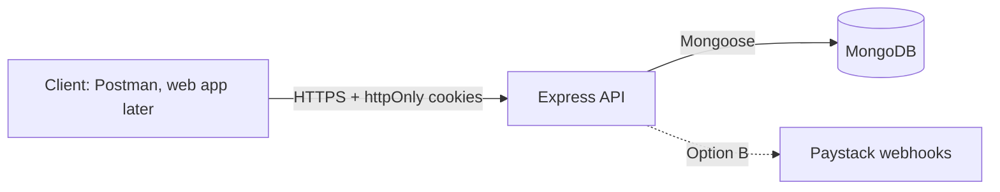
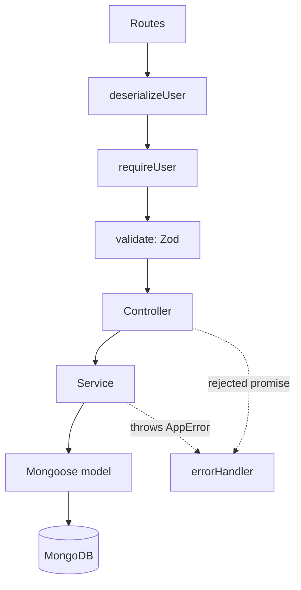
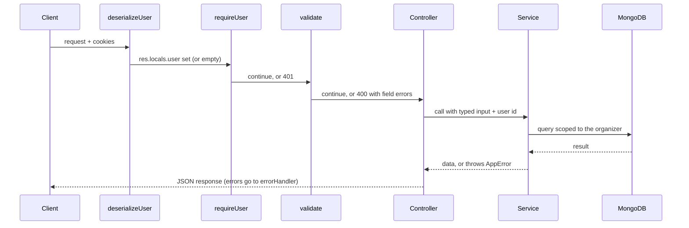
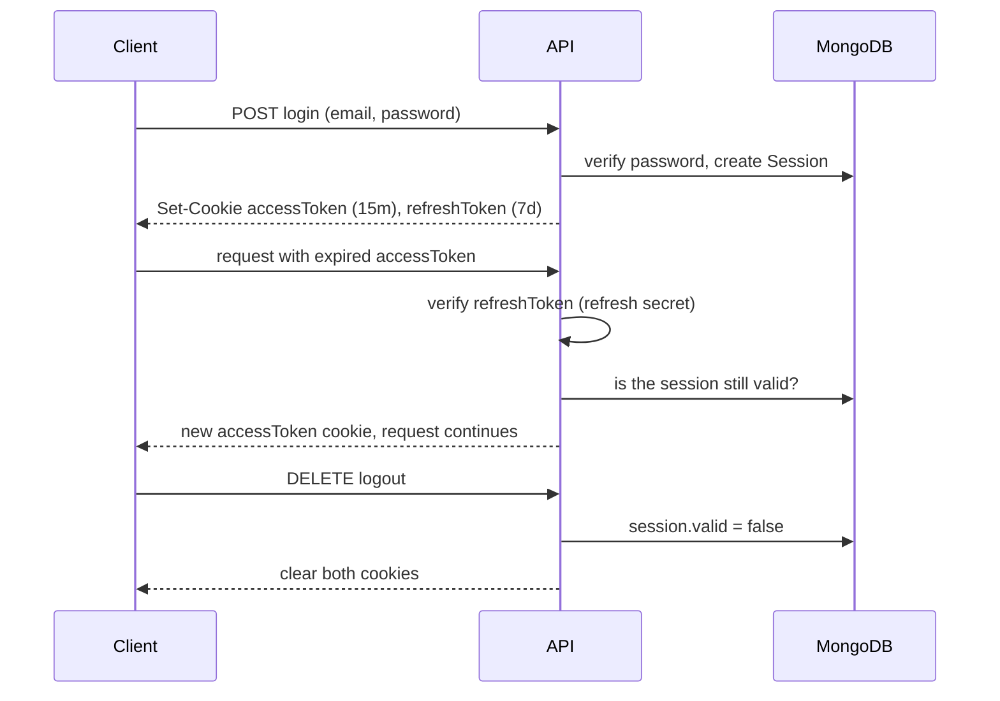

# Architecture

REST API built with TypeScript, Express 5, MongoDB (Mongoose), Zod, JWT, and Jest with Supertest and mongodb-memory-server. Compiled to CommonJS.

## System context



## Layers

Each layer has one job. A request only moves downward, and errors move back up.



| Layer | Responsibility | Does not do |
| --- | --- | --- |
| Routes | Map method and path to middleware and a controller | Any logic |
| `deserializeUser` | Read cookies, verify the access token, refresh it if needed, set `res.locals.user` | Reject requests |
| `requireUser` | Return 401 when there is no user | Check ownership |
| `validate` | Parse `body`, `query`, `params` with Zod (`strictObject` for bodies) | Business rules |
| Controller | Read the request, call one service, choose the status code, shape the response | Business rules, database access |
| Service | Business and data rules, ownership checks, throws `AppError` | Anything HTTP-specific (cookies, status codes) |
| Model | Schema, indexes, document methods | Business rules |
| `errorHandler` | Turn thrown errors into responses; log unexpected ones | Leak internals |

**Where an `if` goes:** if the rule would still apply when something other than an HTTP request calls the function (a script, a job, a Paystack webhook), it belongs in the service.

## Request lifecycle (protected route)



## Authentication flow

Two tokens plus a database session record. Both tokens carry the session id.



Access and refresh tokens use different secrets. After logout the refresh path stops working immediately; an already-issued access token stays valid until it expires (at most 15 minutes).

## Folder structure

```
src/
  app.ts            Express app (middleware, routes, error handler)
  server.ts         Entry point: env, DB connection, listen
  config/           env.ts (typed env vars), cookie options
  route/            Route definitions
  controller/       HTTP layer
  service/          Business rules
  models/           Mongoose schemas and document types
  schema/           Zod schemas and inferred input types
  middleware/       deserializeUser, requireUser, validate, errorHandler
  utils/            jwt-utils, logger, assert-valid-id
tests/              Supertest integration tests and service tests
docs/               This folder
```

## Key decisions

| Decision | Why |
| --- | --- |
| Routes -> controller -> service -> model | One place for each kind of change; services are reusable by webhooks later |
| Services throw, `errorHandler` responds | Express 5 forwards rejected promises, so controllers need no try/catch |
| Input types come from Zod, not Mongoose documents | The input type describes what a client may send; the document type describes what is stored |
| Organizer comes from the token, never the body | `strictObject` rejects an `organizer` field outright |
| Other users' resources return 404 | Doesn't confirm that an id exists |
| Access + refresh tokens + Session record | Real logout and revocation without a database lookup on every request |
| Money in integer kobo | No floating-point errors; matches Paystack |
| `Member` separate from `User` | Option A to B is additive, not a rewrite |
| Cookies (httpOnly, sameSite strict) instead of Authorization headers | Tokens aren't readable by browser JavaScript |

## Option A to Option B

| Option A (current) | Option B (later) |
| --- | --- |
| Only the organizer has an account | Members sign up and join via invite, linking `members.userId` |
| Organizer marks contributions as paid (`method: manual`) | Paystack webhook calls the same "mark paid" service with `method: paystack` |
| One role | A role field plus authorization checks in middleware |

Cycle and payout rules live in services, so they don't change.